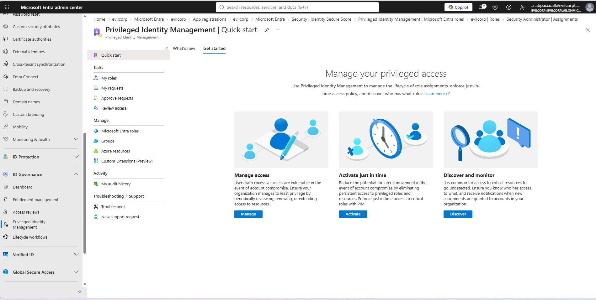

# Implementing Microsoft Entra PIM Just-In-Time (JIT) Workflow: Security Administrator Role

This guide walks through configuring, requesting, and approving Just-In-Time (JIT) privileged access using Microsoft Entra Privileged Identity Management (PIM) for SC-300 exam preparation and portfolio documentation.

---

## Step 1: PIM Overview & Setup
We start by reviewing the core Privileged Identity Management dashboard to manage access workflows.
* **Dashboard View:** Access the main PIM interface to oversee role assignments and security governance.

---

## Step 2: Assigning Eligible Roles
Next, we select the specific administrative role to restrict under JIT control. Here, we choose the **Security Administrator** role from the directory to make users eligible rather than permanently active[cite: 15].

---

## Step 3: Auditing Role Assignments
After making the user (`damencruz`) eligible, we verify the action details and transaction logs in the audit history.

---

## Step 4: Role Activation Stage (JIT Request)
Logged in as the test user (`damencruz`), we navigate to **My roles** where the *Security Administrator* role appears under **Eligible assignments**. Clicking **Activate** begins the JIT escalation process.

---

## Step 5: Configuring Approval Policies
As a Global Administrator, we update the role settings to require explicit activation approval and designate authorized approvers (such as `maximo dawan`) to govern privilege elevations[cite: 13].

---

## Step 6: Reviewing and Approving Requests
Once the user submits an activation request with a business justification, the designated administrator reviews it in the **Approve requests** queue and grants approval[cite: 14].

---

## Step 7: Verifying Active Elevation
Finally, returning to the user's PIM dashboard under **Active assignments**, we confirm that the *Security Administrator* role is successfully activated with its active session countdown[cite: 16].

